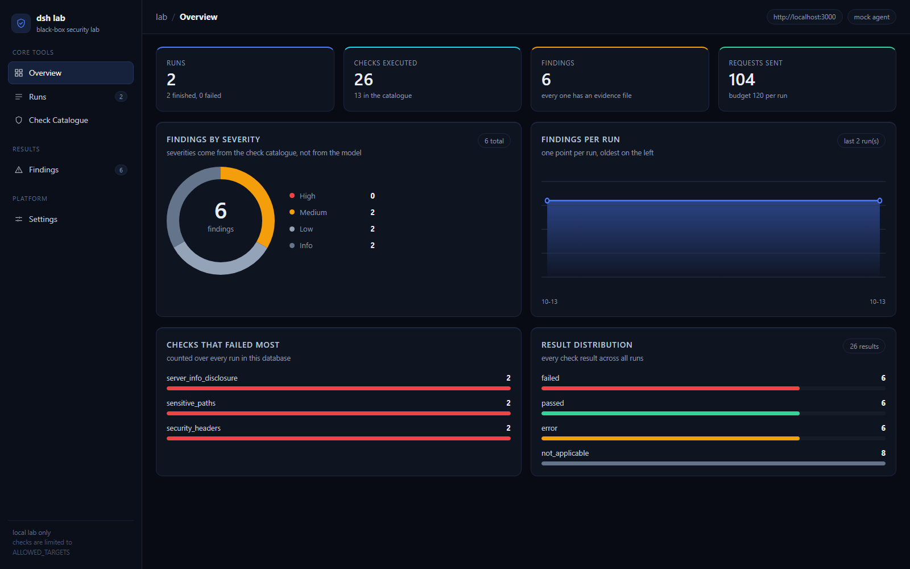
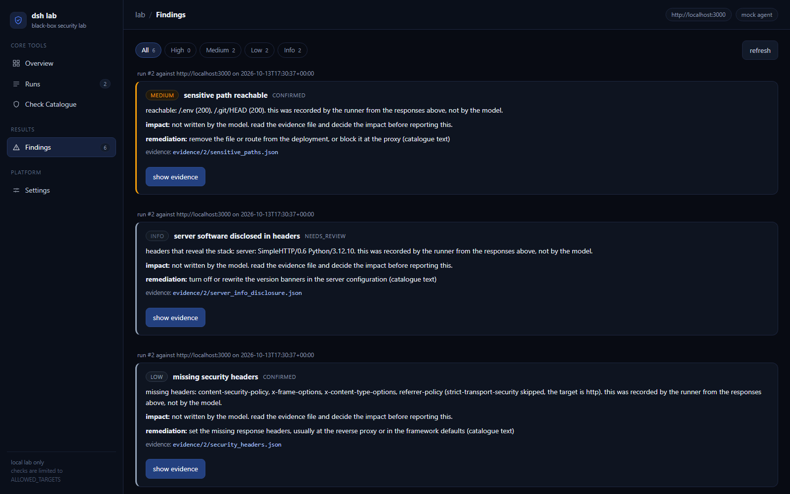

# deepseek black-box security lab

a small local lab that tests a running web app from the outside. a deepseek model picks which
checks to run and writes up the findings. ordinary python code sends the requests, records the
responses, and decides whether each check passed or failed.

the default target is OWASP Juice Shop in docker on localhost:3000.

## the idea

the interesting part of this project is where the model is and is not allowed to decide.

the model does two things:

1. it looks at a short recon summary and picks which checks to run from a fixed catalogue, with a reason for each
2. it writes the impact and remediation text for findings that the code already confirmed

the model does not do these things:

- it cannot add a check that is not in the catalogue, unknown ids are dropped
- it cannot decide a result, the pass or fail comes from the recorded status code and response body
- it cannot set a severity, severities live in the catalogue in code
- it cannot create a finding, a finding is only written when a check failed and its evidence file is on disk
- it cannot mark anything as verified

so the results table is evidence and the summary paragraph is commentary. the report and the
dashboard both label which is which.

## the dashboard



five pages, each one showing something the backend actually stored:

| page | what is on it |
|---|---|
| overview | run, check, finding and request totals, findings by severity, findings per run, the checks that failed most, and the spread of results |
| runs | start a run, the run list with live progress, and the detail for one run with tabs for results, plan, findings and the markdown report |
| check catalogue | all 13 checks with their severity, what they send, and the fallback fix text |
| findings | every finding from every run, filterable by severity, with the impact, remediation and raw evidence |
| settings | the values the backend loaded, and where data, evidence and reports are written |

the overview and the finding cards are built from real runs only, nothing is seeded. the screenshot
above is two smoke runs against a throwaway local http server on purpose, so the numbers are small.

each page has a url, so it can be linked to directly: `#overview`, `#runs`, `#catalogue`,
`#findings`, `#settings`.




## how a run works

```
POST /api/runs or cli run
  scope check        the target has to match ALLOWED_TARGETS exactly (scheme, host and port)
  recon              GET /, OPTIONS /, HEAD /, counted against the request budget
  planning           deepseek returns a json list of check ids and reasons (or the fallback plan)
  execution          each check sends its requests, one at a time, with a delay between them
  evidence           evidence/<run_id>/<check_id>.json gets the request, status, headers and body
  findings           written in code, only for failed checks that have an evidence file
  write up           deepseek writes impact and remediation for each finding
  report             reports/run_<id>.md
```

if a check fails but its evidence file cannot be written, the check is recorded as `error` and no
finding is created. a failed check with no evidence is not a finding.

## the checks

13 checks, all black-box, none of them destructive. every one of them can be confirmed from a
recorded response, and there is no fuzzing or exploitation beyond a login probe on a lab that is
built to be probed.

| id | category | severity | what it does |
|---|---|---|---|
| `security_headers` | misconfiguration | low | looks for missing csp, x-frame-options, x-content-type-options, referrer-policy (hsts is skipped on http targets and required on https) |
| `server_info_disclosure` | information leak | info | reports `server`, `x-powered-by` and similar headers |
| `cookie_flags` | session handling | medium | checks set-cookie on the main page and the login endpoint for secure, httponly, samesite |
| `cors_policy` | misconfiguration | medium | sends `origin: https://evil.example` and checks if it is reflected, especially with allow-credentials |
| `http_methods` | misconfiguration | low | sends options and trace, flags trace answering 200, and notes risky methods that are only advertised |
| `robots_disclosure` | information leak | info | reads robots.txt and sitemap.xml for path hints |
| `sensitive_paths` | exposure | medium | 16 fixed paths (`/.env`, `/.git/HEAD`, `/ftp`, `/metrics`, ...). only content served without authentication is a finding |
| `error_disclosure` | information leak | low | sends malformed input, looks for stack traces and database errors in the body |
| `sql_injection_login` | injection | high | baseline bad login, then `' OR 1=1--`, compares the two responses |
| `reflected_xss` | injection | high | puts a marker plus a script tag in the search parameter, checks if the tags come back unencoded in an html response |
| `open_redirect` | misconfiguration | medium | tries the `to`, `next` and `url` parameters with an off site address |
| `weak_credentials` | authentication | high | tries 5 well known demo passwords against the login endpoint |
| `rate_limit` | authentication | low | 10 quick failed logins, reports throttling when it appears as a 429, a lockout, or clearly slower answers |

a check returns one of five results, and each one has an evidence requirement. this is the part
that keeps the report honest, so it is worth reading before the check list:

| result | what the evidence has to show | becomes a finding |
|---|---|---|
| `failed` | the recorded response directly demonstrates the condition the check describes (a header really is absent, a payload really was accepted, a file really was served) | yes, `confirmed` |
| `needs_review` | the response is consistent with the condition but does not demonstrate it (a 403 instead of a 200, no 429 seen after 10 tries, a wildcard cors header, a script tag reflected as json, a consent cookie, a method only advertised in `Allow`) | yes, `needs_review` |
| `passed` | the specific thing was checked and not found. it never means the target is clean | no |
| `not_applicable` | the check could not reach a conclusion at all (nothing reflected, no cookie set, no `Allow` header) | no |
| `error` | the check could not run (tls failure, timeout, budget reached, endpoint missing) | no |

so a 403 on `/.env` is an observation that the path exists and is refused (which is correct
behaviour), not an exposure. ten login attempts that are all answered normally are an observation,
because ten requests cannot show that throttling is absent. and a `*` cors header is an
observation, because nothing sensitive was shown to be readable.

the same rule made two checks stricter in the other direction: `TRACE` answering with 200 is
directly demonstrated, so `http_methods` reports `failed` for that and `needs_review` for a method
that is merely listed in `Allow`.

findings from `needs_review` results are marked `needs_review` instead of `confirmed`, and the
report and dashboard both show which is which.

`sensitive_paths` compares each 200 response against the app root. single page apps answer 200
with the app shell for unknown paths, and reporting that as an exposed file would be a false
positive, so identical bodies are ignored.

## safety limits

these are all in ordinary code, outside the model:

- the target has to match an entry in `ALLOWED_TARGETS` exactly, so `http://localhost:3001` is refused when only `http://localhost:3000` is listed
- redirects are never followed. every request is sent with `allow_redirects=False`, so there are no redirect hops to validate and no way for a redirect to walk the runner off the allowed host. `open_redirect` records the `Location` header without visiting it
- `MAX_REQUESTS_PER_RUN` (default 120) is counted **before** each request goes out, so a timeout, a refused connection or an error still costs budget. a refused request (off host, or over budget) costs nothing, because nothing was sent
- `REQUEST_DELAY_MS` (default 200) between requests
- response bodies are truncated to 8kb when read and to 2kb in the evidence files
- login evidence keeps the response body so a finding can be checked, but the value of any `token` or `password` field is replaced with `[redacted]`
- the evidence endpoint only serves files for check ids that exist in the catalogue, so the path cannot be talked out of the evidence folder
- the api key is only read from the environment, `.env` is gitignored

keep this pointed at your own lab. the scope check is there to make an accident harder, not to
make hostile use acceptable.

## setup

python 3.12 or newer, node 20 or newer for the dashboard, docker for the lab target.

```powershell
# 1. the lab target (start docker desktop first)
docker compose -f lab/docker-compose.yml up -d
# juice shop is then on http://localhost:3000

# 2. python environment
python -m venv .venv
.\.venv\Scripts\python.exe -m pip install -r backend\requirements.txt

# 3. settings
copy .env.example .env
# then put your key in .env: DEEPSEEK_API_KEY=sk-...
```

`.env` keys:

| key | default | meaning |
|---|---|---|
| `ALLOWED_TARGETS` | `http://localhost:3000` | comma separated list of targets a run may touch |
| `DEEPSEEK_API_KEY` | empty | required unless `MOCK_AGENT=1` or the run uses `--only` |
| `DEEPSEEK_MODEL` | `deepseek-chat` | model name sent to the api |
| `MAX_REQUESTS_PER_RUN` | `120` | hard cap for one run |
| `REQUEST_DELAY_MS` | `200` | pause between requests |
| `REQUEST_TIMEOUT` | `10` | seconds per request |
| `CA_BUNDLE` | empty | path to a ca certificate file, only for a lab target with a self signed certificate. adds a ca, never turns checking off |
| `MOCK_AGENT` | `0` | 1 skips the api and uses the fallback plan |
| `LOGIN_PATH` | `/rest/user/login` | the login endpoint the auth checks use |
| `SEARCH_PATH` | `/rest/products/search` | the search endpoint the xss check uses |
| `LAB_CREDENTIALS` | 5 demo logins | `email:password` pairs for the weak credentials check |

## http and https targets

both schemes are accepted, and the scheme is part of the allowlist match, so `https://localhost:3000`
and `http://localhost:3000` are two different targets and each has to be listed:

```ini
ALLOWED_TARGETS=https://localhost:3000
```

- certificate checking stays on. nothing in the code passes `verify=False`, and there is no option
  to turn it off. a failure is reported as `error`, never as a finding
- if the lab target uses a self signed certificate, point `CA_BUNDLE` at the ca file and the checks
  run normally:
  ```ini
  CA_BUNDLE=C:/certs/lab-ca.pem
  ```
  a relative path is resolved from the project folder. if the file is missing the run stops with a
  clear message instead of failing on every request
- over https, `security_headers` requires `strict-transport-security`. over http it skips it,
  because browsers ignore hsts on plain http
- redirects are never followed, over either scheme. a `302` to another host is recorded in the
  evidence as the response, and no request is made to the destination

what a connection problem looks like, rather than a vulnerability:

| what happened | recorded as |
|---|---|
| untrusted or self signed certificate | run `failed`, or the check `error`, with `tls certificate verification failed` and no finding |
| host refuses the connection | `could not connect to <target>` |
| host accepts but never answers | `did not answer within 10s` (or whatever `REQUEST_TIMEOUT` is) |
| budget reached mid check | that check `error` with `request budget of 120 reached`, the run still finishes |

## running it

from the terminal:

```powershell
# see what the agent is allowed to ask for
.\.venv\Scripts\python.exe -m backend.cli checks

# a full run, the model plans the checks
.\.venv\Scripts\python.exe -m backend.cli run --target http://localhost:3000 --notes "first run"

# no api calls, useful for testing the pipeline without a key
.\.venv\Scripts\python.exe -m backend.cli run --mock --only security_headers,sensitive_paths

# what has been run so far
.\.venv\Scripts\python.exe -m backend.cli runs
```

the dashboard:

```powershell
# backend on http://127.0.0.1:8000
.\.venv\Scripts\python.exe -m uvicorn backend.app:app --host 127.0.0.1 --port 8000

# in another terminal, the dev server on http://localhost:5173, it proxies /api to the backend
cd frontend
npm.cmd install
npm.cmd run dev
```

or build the dashboard once and let the backend serve it, so everything is on port 8000:

```powershell
cd frontend
npm.cmd run build
```

the api the dashboard talks to:

| endpoint | what it returns |
|---|---|
| `GET /api/health` | the settings the backend loaded, whether a key is present, and the allowlist |
| `GET /api/checks` | the check catalogue |
| `GET /api/stats` | the totals and series the overview page draws |
| `GET /api/findings` | every finding across all runs, newest first |
| `POST /api/runs` | start a run (the body is the target and notes) |
| `GET /api/runs` | the run list with finding counts |
| `GET /api/runs/{id}` | one run with its plan, results and findings |
| `GET /api/runs/{id}/report` | the markdown report |
| `GET /api/runs/{id}/evidence/{check_id}` | the raw evidence json, only for catalogue check ids |

tests:

```powershell
.\.venv\Scripts\python.exe -m pytest backend/tests
```

the checks are tested against an in-process fake target (a small `http.server` in
`backend/tests/fake_target.py`) with a deliberately sloppy mode and a hardened mode, plus single
behaviour switches so one check can be pinned down at a time. the https tests use a throwaway
certificate authority in `backend/tests/certs/` so they need no network and no extra package.

## the behaviour matrix

`backend/tests/test_behaviour_matrix.py` holds 37 labelled cases. each one states what the target
does and what result the check has to return, written by hand next to the behaviour rather than
taken from the check. if a check starts claiming more than its evidence supports, the row fails.

```
37 cases covering all 13 checks
12 expect failed          12 expect passed
 9 expect needs_review     4 expect not_applicable
plus 1 run level row where the host is dead and the run has to fail without a finding
```

each row also asserts the finding status, so the vocabulary is tested end to end: `failed` has to
produce a `confirmed` finding, `needs_review` has to produce a `needs_review` finding, and the
other three results must produce no finding at all.

this is not a precision and recall benchmark, and i am not going to dress it up as one. the target
and the labels come from the same person, so recall here is true by construction. what it does
prove is that each check returns the documented result for a known behaviour, and that the cases
which used to be over-claimed now land in `needs_review`. real precision and recall would need a
hardened application with labels nobody derived from this code.

## what works and what i have verified

verified:

- 82 pytest tests pass (`82 passed in 40.29s`), covering the checks in both fake target modes, the 37 case behaviour matrix, the scope rules over both schemes, the request budget including failed attempts, the evidence-before-finding rule, the stats queries, the interrupted run cleanup and report generation
- a full run against OWASP Juice Shop in docker: with the fallback plan (48 requests) and with the real model (12 checks planned by deepseek, 47 requests, 8 findings, `reports/run_3.md`)
- the real deepseek call works end to end: the model planned 12 of the 13 checks with a reason each, wrote the impact and remediation for all 8 findings, and wrote the summary. every one of those texts is labelled as model written in the report and the dashboard
- the headline finding was checked by hand, not just trusted: a normal bad login returned `401` with 26 bytes of html, and `' OR 1=1--` returned `200` with 799 bytes of json reading `{"authentication":{"token":"[redacted]","bid":1,"umail":"admin@juice-sh.op"}}`, so the injection logs in as the first admin user
- the false positive fixes were re-run against Juice Shop and moved claims in both directions: its `Access-Control-Allow-Origin: *` now reports `needs_review` with "whether anything sensitive is readable was not established" instead of a confirmed finding, `rate_limit` now reports an observation instead of "no throttling", while `http_methods` (TRACE really answered 200) and `robots_disclosure` (the file really lists paths) moved from `needs_review` to `confirmed`, because those are demonstrated
- a run against a second, external target (`https://pentest-ground.com:81`, listed by OWASP as intentionally vulnerable) ran end to end over tls: 52 requests, 3 confirmed findings, 1 observation, and 3 checks correctly reported `error` because that app has no `/rest/user/login`, rather than inventing findings
- the interrupted run cleanup was checked against the real database: a run left in progress by a killed process now shows `failed` with "the process that started it is gone", instead of staying `running` forever
- tls behaviour is verified against a real tls socket: a trusted local ca is tested normally, an untrusted certificate fails the run with a clear message and zero findings, and a per check tls failure becomes `error`
- the dashboard typechecks, builds, and its five pages were each loaded in a browser against real data from those runs, which is where the screenshots in this readme come from

not verified:

- a hardened real target. the only clean target the checks have run against is the fake one in the tests, so the pass branches are tested, but not against a real hardened application
- nothing browser based is tested at all, because there is no browser in the pipeline

## known limitations

- one target at a time, and only targets on the allowlist
- no session or login handling, so anything behind a login is out of reach
- the injection checks are shallow: one login payload and one reflected marker. they can show a problem exists, they cannot show a target is clean
- no browser, so most client side issues are out of reach. `reflected_xss` can only judge reflection, not whether a page actually executes it, and `open_redirect` only sees server side redirects
- redirects are never followed at all, which is deliberate. a target that only exposes a problem behind a redirect, such as a login page at a new path, is not tested
- `needs_review` is a judgement call made by the check, not by a person at run time. it means "the evidence does not demonstrate this", which is not the same as "this is probably fine"
- `cors_policy` only asks the main page, so it cannot tell whether a credentialed api endpoint is readable. it says so in the result
- checks run one at a time on purpose, so the request budget stays honest and the target is not hammered
- the run executes in a thread inside the api process, so stopping the api kills a run in progress. that run is then marked `failed` as interrupted the next time the backend starts, because a run only lives inside the process that started it and the row records that process id. this is not a job queue and there is no resume
- the pid check that closes interrupted runs is windows specific in its implementation (it asks the process handle instead of using `os.kill`, which is not a usable probe there). on other platforms it falls back to `os.kill(pid, 0)`, which i have not tested
- starting two runs at the same time works (each has its own budget) but both hit the same target
- the model summary can be vague or wrong. that is exactly why the result column never comes from the model
- the reasons in the plan table are model commentary, not evidence. against juice shop the model wrote things like "juice shop is famous for accepting well-known demo credentials", which is prior knowledge of a well known target rather than something the recon showed. treat the plan as the agent explaining itself, not as a finding
- `LAB_CREDENTIALS` defaults to public juice shop demo logins, so `weak_credentials` is not meaningful against a different target unless you change that list
- the test certificates expire in 10 years. after that the https tests fail with a verification error and `backend/tests/certs/README.md` explains how to regenerate them

## not built yet

- screenshots as evidence (would need playwright)
- a zap baseline scan as one more check id
- jwt checks (alg none, weak secret)
- pdf export of the report

## layout

```
backend/
  app.py         fastapi endpoints
  cli.py         run a test from the terminal
  config.py      .env loading and defaults
  scope.py       the only place that builds a request url, plus the budget, the delay, the tls ca and the error types
  catalogue.py   the explicit check list with severities and fallback fixes
  checks.py      the http checks, the result vocabulary and the pass or fail decisions
  runner.py      recon, planning, execution, findings, report
  agent.py       the three deepseek calls
  db.py          sqlite schema and queries
  report.py      markdown report
  tests/         pytest, with the fake target, the behaviour matrix and the test certificates
frontend/        react + typescript + vite dashboard
  src/api.ts     the fetch calls the pages use
  src/theme.ts   severity and result colours and ordering
  src/components/ Sidebar, Dashboard, RunsView, RunDetail, Catalogue, FindingsView, SettingsView, charts
  src/components/charts.tsx  the stat card, donut, area chart and bar list, plain svg, no chart library
lab/             docker compose for juice shop
docs/            the dashboard screenshots used in this readme
data/            sqlite file (gitignored)
evidence/        raw requests and responses per run (gitignored)
reports/         markdown report per run (gitignored)
```

## what i learned

- keeping a model inside a narrow role is more about what the code refuses to take from it than about the prompt. the model returns check ids, and the code validates them against a list and ignores everything else
- a "scanner" is really a pile of small explicit http checks with a written down decision rule for each one. most of the work is deciding what counts as a result
- evidence has to be written before a finding exists, otherwise the report makes claims the run cannot back up
- a false positive is usually a wrong assumption about the framework, not a bug. the single page app fallback answering 200 for `/admin` is the example that bit me here
- a check's result is a claim, and the claim has to match the evidence. splitting "the response shows this" from "the response is consistent with this" removed more over-claiming than any amount of threshold tuning, and it made three checks report more, not less, because trace answering 200 and robots.txt listing a path really are demonstrated
- a request budget that is only incremented after a response is not a budget. timeouts and refused connections were free, which is the opposite of what you want when the target is misbehaving
- one ordering detail cost me a confusing failure: `requests.exceptions.ConnectTimeout` inherits from both `ConnectionError` and `Timeout`, so whichever you catch first decides whether a refused host is described as unreachable or slow
- testing a security tool without a vulnerable target needs a fake target with a bad mode and a good mode, and single switches per behaviour, otherwise you only ever test the failing branch
- sqlite needed WAL because a worker thread writes results while the dashboard polls the same file

## notes for anyone reading the code

- `checks.py` has no severity or title logic, and `catalogue.py` has no http logic. the runner joins them, which is why the two lists are checked against each other in the tests
- `Scope.request` is the only place a request is sent. everything else goes through it, which is what makes the allowlist check and the budget actually hold
- the model prompts are three short constants in `agent.py`, not a prompt framework
